# Market-Compliance Image Editing

**Finding what a market can't show in a photo, and fixing it automatically.**

A prototype I built in 2026 for a global hotel group. This repo shows the results. The code is private. I'm happy to walk through it in an interview.

<table><tr>
<td align="center"><b>Before</b> 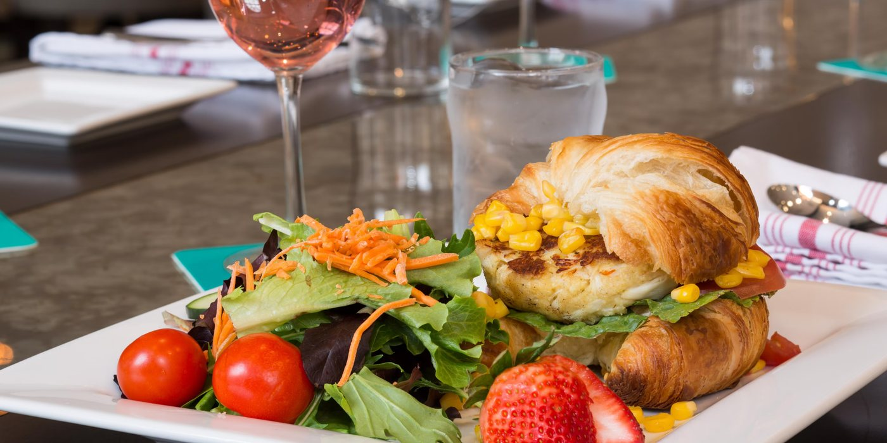</td>
<td align="center"><b>After</b> 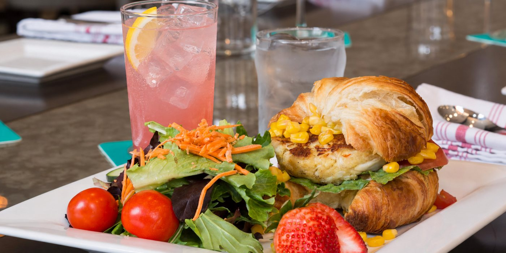</td>
</tr></table>

## The problem

Some markets can't show alcohol or pork in marketing images. A global hotel group has a huge photo library, and nobody wants to flag every photo by eye, then brief a retoucher on every one.

## What I built

A pipeline that runs headless on a whole folder of photos. Nobody has to configure each photo first:

1. **Detect.** Claude's vision model scans each photo and flags alcohol or pork, with a confidence score.
2. **Write its own instructions.** For every hit, it writes a custom edit for that photo: what the item is, where it is, and a specific replacement.
3. **Render two ways.** OpenAI and Gemini both make the edit side by side, so the better one can be picked.
4. **Check its own work.** A second AI pass compares the original, the edit and the instruction, and flags anything that looks fake or anything else in the frame that changed.
5. **A person signs off.** Nothing approves itself. The checks exist to make human review fast, not to replace it.

> **The same command runs 20 photos or 2,000.**

## Results

<table>
<tr><td align="center"><b>Before</b></td><td align="center"><b>After</b></td></tr>
<tr><td>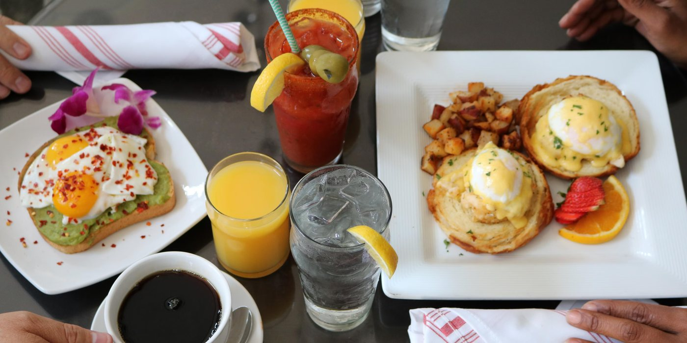</td><td>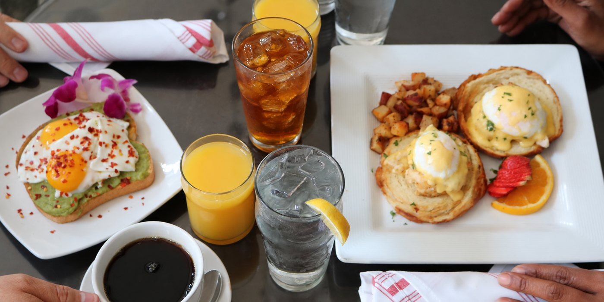</td></tr>
<tr><td>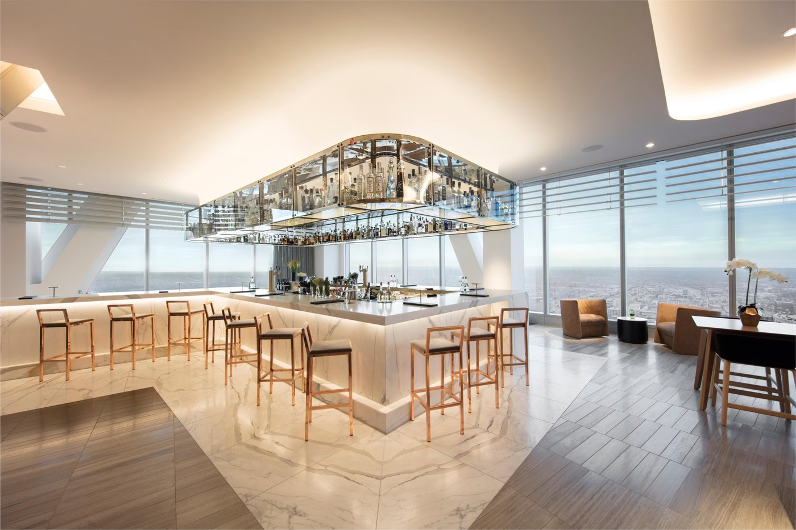</td><td>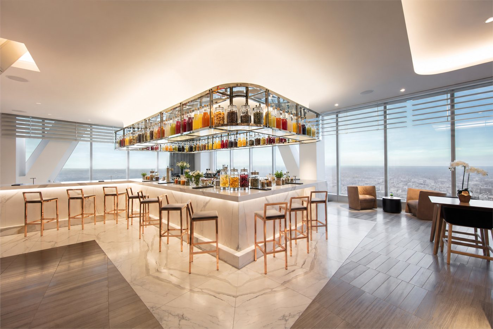</td></tr>
<tr><td>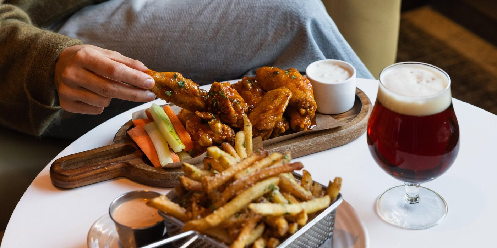</td><td>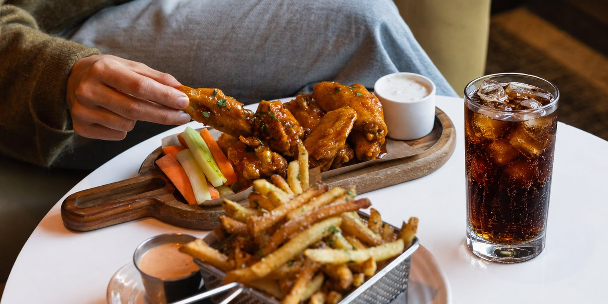</td></tr>
<tr><td>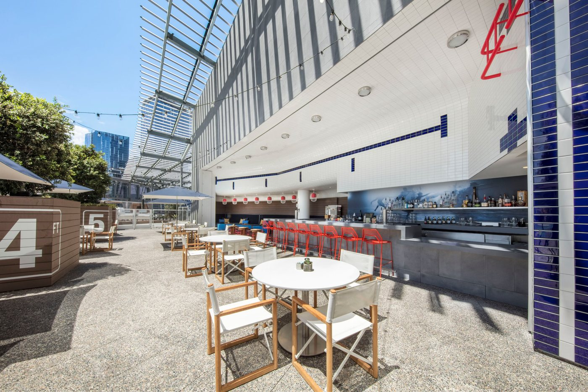</td><td>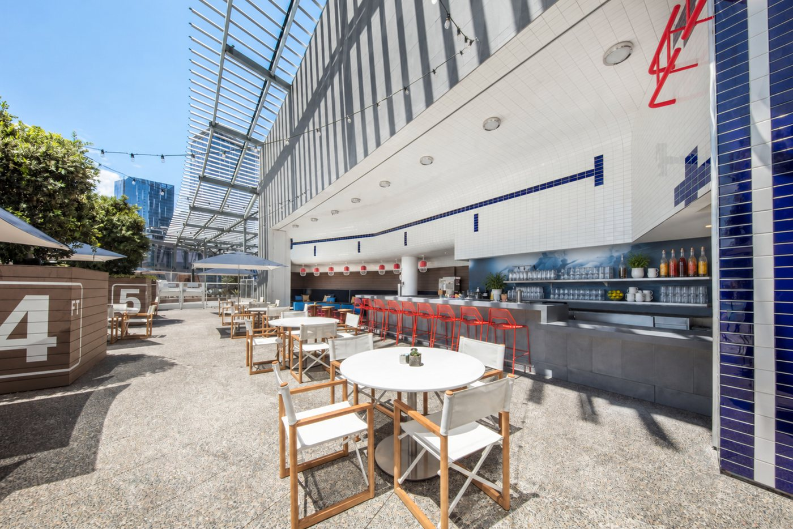</td></tr>
<tr><td>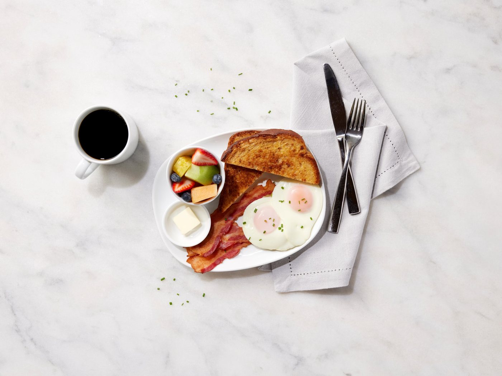</td><td>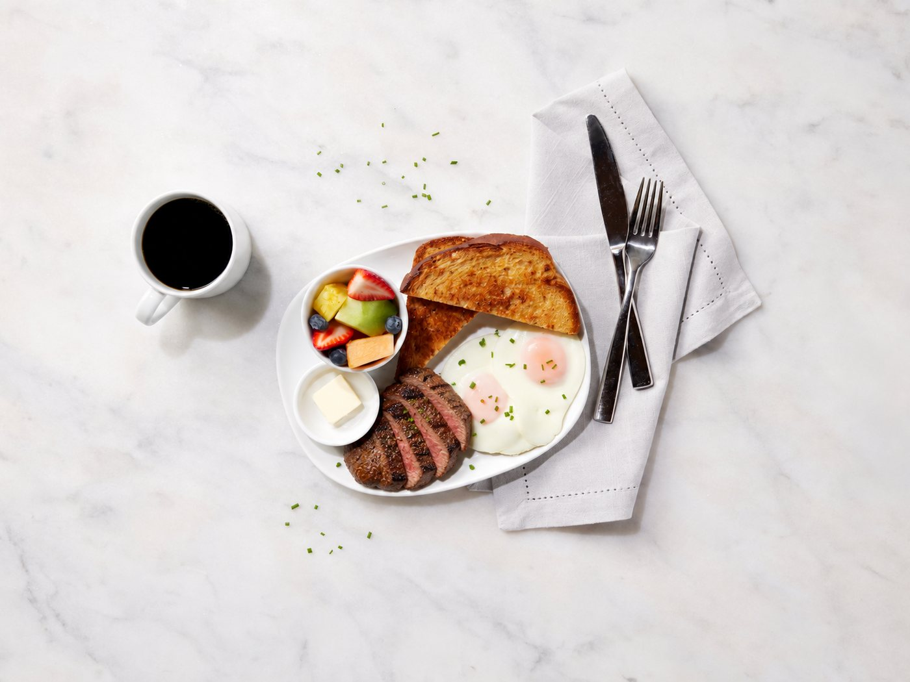</td></tr>
<tr><td>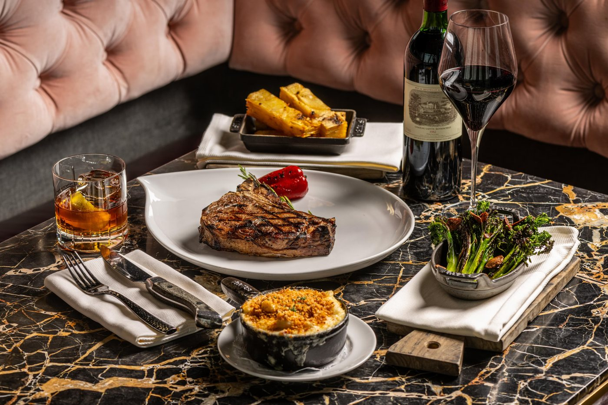</td><td>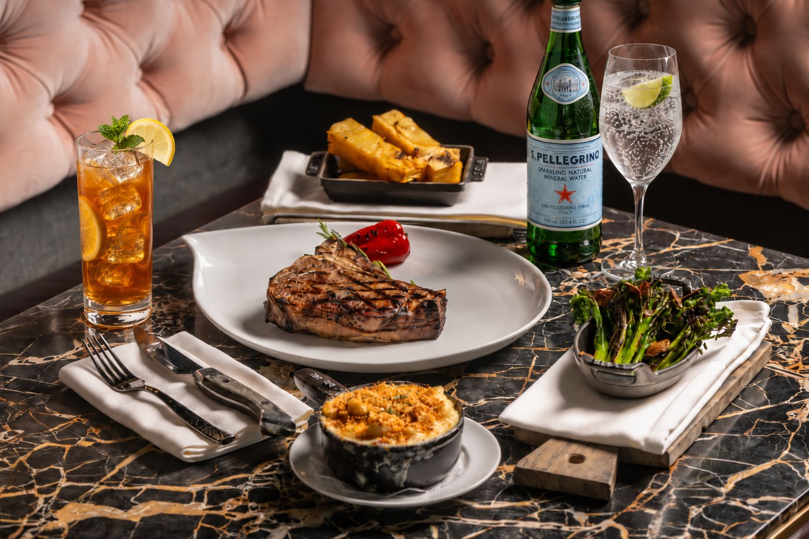</td></tr>
</table>

## How it got good: three versions

- **Version 1: one generic instruction for every photo.** The AI only answered yes or no, and every flagged photo got the same template edit. Results were hit and miss: a tomato juice that still looked like a Bloody Mary, and edits so vague the photo barely changed.
- **Version 2: the AI writes the edit for each photo.** A big jump in quality. But it kept making choices a person would catch right away, like swapping bacon for turkey sausage (no pork, but it still looks like sausage) or dropping raw peppers onto an English muffin in the exact shape the bacon had been.
- **Version 3: rules plus a self-check.** The instruction writer now has to pick a genuinely different food or drink, not a look-alike, and not a "mocktail" in a martini glass. Then a second pass reviews every result. On one photo it flagged a water bottle whose label had turned into gibberish, a problem nobody had thought to warn it about.

## Honest limits

- There's no mask, so it can't guarantee that nothing else moves. The self-check flags drift; it doesn't prevent it.
- Text on labels and signs is a weak spot for every image model. Anything with lettering gets a human look no matter what.
- Every result goes to a person. That's the design, not a gap.

---

**Built with:** Python · Claude vision · OpenAI image editing · Gemini image editing
**Related:** [Hotel photo relighting](https://github.com/secretgrampuh/hotel-photo-relighting), from the same project · [Full portfolio](https://secretgrampuh.github.io)
**Contact:** [lamplughvideo@gmail.com](mailto:lamplughvideo@gmail.com) · [LinkedIn](https://www.linkedin.com/in/zachary-l-7b384833/)
